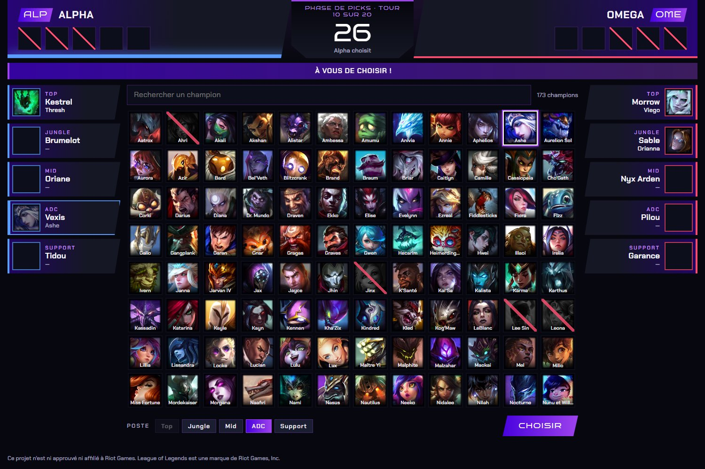
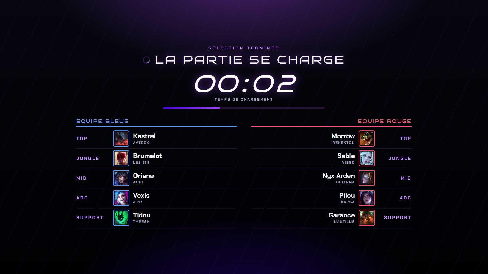
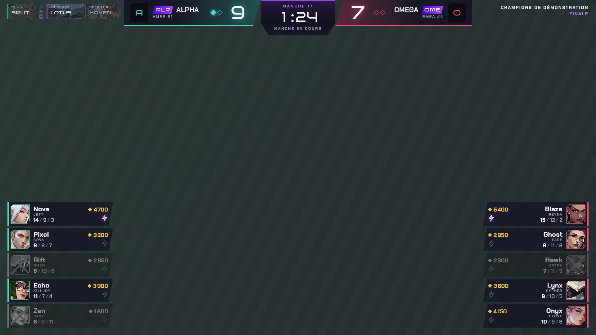
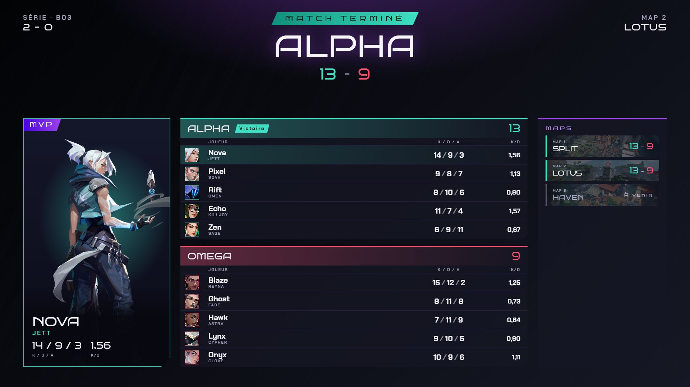
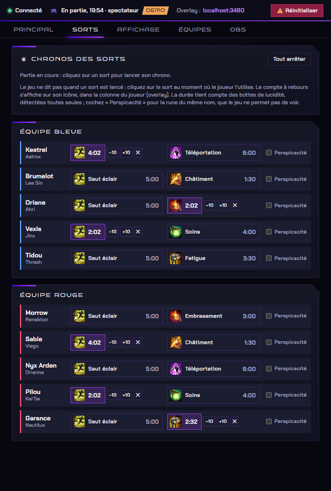
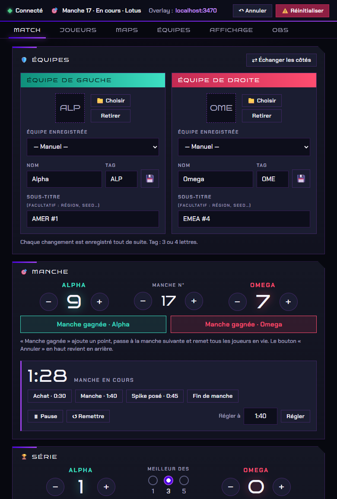
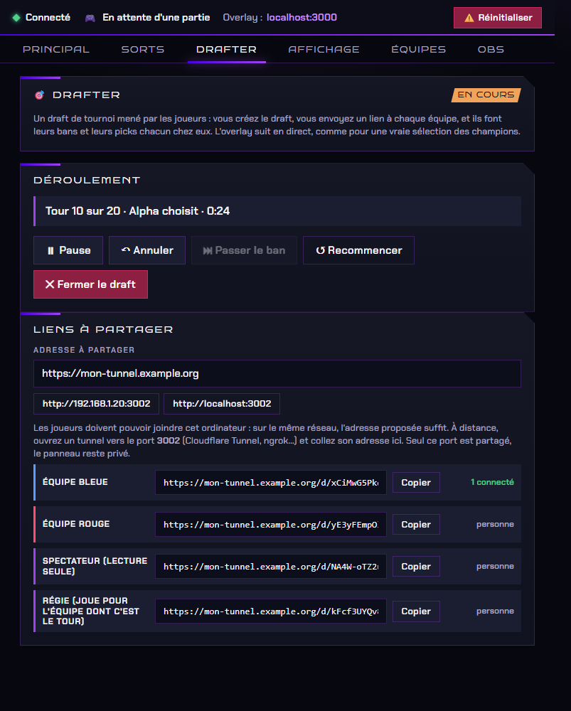

# Overlay Twitch pour League of Legends et VALORANT

Un overlay de diffusion pour OBS, sur le même principe que JotaOverlay pour Rocket League : un petit programme local fournit les données du match, une page « overlay » s'ajoute dans OBS comme **source navigateur**, et un **panneau de contrôle** règle les noms d'équipes, les logos, le score de la série et ce qui s'affiche. Le design suit la charte graphique Genesis. Au lancement, on choisit le jeu :

- **League of Legends** : un serveur lit les données de la partie en cours dans l'API officielle et locale du jeu, la *Live Client Data API*. Il n'y a **aucune lecture de la mémoire du jeu** (donc aucun souci avec Vanguard) et **aucune clé API Riot** à demander.
- **VALORANT** : le jeu n'offre pas d'API locale pour le score, les crédits ou les K/D/A de tous les joueurs. L'overlay est donc **piloté à la main** depuis le panneau (manches, chrono, maps, joueurs), comme les overlays de tournoi pilotés par un régisseur.

**Pas encore de version à télécharger** : l'application se fabrique en trois commandes, voir « Fabriquer l'application » plus bas. Pour essayer tout de suite, installez [Node.js](https://nodejs.org) et double-cliquez sur `start-demo.bat` (LoL) ou `start-valorant.bat --demo` (VALORANT).

> Ce projet n'est ni approuvé ni affilié à Riot Games. League of Legends et VALORANT sont des marques de Riot Games, Inc. Les icônes de champions et d'objets viennent de Data Dragon, le service public de Riot pour les développeurs ; les images des agents et des maps de VALORANT viennent de [valorant-api.com](https://valorant-api.com), une API communautaire.

## Captures d'écran








<p align="center">
  
  
</p>
<p align="center">
  
  
</p>

*Les captures viennent des modes démo, avec des équipes et des joueurs fictifs : aucun vrai joueur, aucun logo.*

## Mise en place pour le stream : League of Legends

1. **Lancer l'application**
   - [ ] Ouvrez `Overlay-LoL.exe` (ou double-cliquez sur `start.bat` si vous utilisez Node.js).
   - [ ] Dans l'écran de choix, cliquez sur **League of Legends**. Le panneau de contrôle s'affiche dans la même fenêtre.
   - [ ] Gardez cette fenêtre ouverte pendant le stream : **la fermer arrête l'overlay dans OBS** (le programme demande confirmation).
2. **Ajouter l'overlay dans OBS**
   - [ ] Dans la scène de jeu : **Sources → + → Navigateur**.
   - [ ] Collez l'adresse (le panneau, onglet **OBS**, la donne avec un bouton « Copier ») :
     ```
     http://localhost:3000/overlay
     ```
   - [ ] **Largeur** `1920`, **Hauteur** `1080`. Le fond est transparent : l'overlay se superpose à la capture du jeu.
   - [ ] Placez la source **au-dessus** de la capture de League of Legends.
   - *Si vous diffusez en 1280×720, laissez quand même la source en 1920×1080 : OBS la réduit avec le reste de la scène.*
3. **Régler le panneau de contrôle**
   - [ ] Onglet **Principal** : noms, tags et logos des équipes, format de la série (BO1, BO3, BO5 ou BO7).
   - [ ] Onglet **Affichage** : mode **Joueur** (le bas de l'écran reste libre pour la barre des sorts) ou **Spectateur** (tableau des joueurs en bas), et les interrupteurs de chaque élément (champions sur les côtés, cadre de la minimap…).
   - [ ] Onglet **Sorts** *(facultatif)* : en spectateur, la **lecture automatique** lance les chronos toute seule (voir « Chronos des sorts : lecture automatique »). Sinon, cliquez sur le Saut éclair d'un joueur quand il l'utilise, son compte à rebours s'affiche dans l'overlay.
   - [ ] Chaque changement est enregistré tout de suite, il n'y a pas de bouton « Enregistrer ».
4. **Picks et bans** *(facultatif, scène dédiée)*
   - [ ] La source `/overlay` les affiche déjà toute seule pendant la sélection des champions.
   - [ ] Pour une scène OBS réservée à la sélection, ajoutez une seconde source navigateur 1920×1080 sur `http://localhost:3000/overlay?view=draft` : elle n'affiche que les picks et bans.
   - [ ] Pour un draft de tournoi où **les joueurs font eux-mêmes leurs bans et leurs picks**, utilisez l'onglet **Drafter** du panneau (voir « Drafter » plus bas) : il donne un lien à envoyer à chaque équipe, et l'overlay suit le draft en direct.
5. **Lancer la partie**
   - [ ] Tout s'enchaîne tout seul : la page des picks et bans, puis la **page de chargement** avec le poste de chaque joueur pendant que la partie se charge, puis l'overlay de la partie.
   - [ ] Dès que la partie est chargée, le statut du panneau passe à « En partie » et l'overlay apparaît.
   - [ ] À la fin, l'écran de fin s'affiche tout seul (en spectateur : cliquez sur « Victoire bleue » ou « Victoire rouge »).

Pas de jeu sous la main ? Double-cliquez sur `start-demo.bat` : la démo complète enchaîne sélection des champions, partie et écran de fin.

## Mise en place pour le stream : VALORANT

1. **Lancer l'application**
   - [ ] Ouvrez `Overlay-LoL.exe` (ou double-cliquez sur `start-valorant.bat` si vous utilisez Node.js).
   - [ ] Dans l'écran de choix, cliquez sur **VALORANT**. Le panneau de contrôle s'affiche dans la même fenêtre. Le bouton **← Jeux** ramène au choix ; l'overlay déjà lancé continue de tourner pour OBS.
2. **Ajouter l'overlay dans OBS**
   - [ ] **Sources → + → Navigateur**, adresse :
     ```
     http://localhost:3001/overlay
     ```
   - [ ] **Largeur** `1920`, **Hauteur** `1080`, au-dessus de la capture du jeu. Le fond est transparent.
3. **Préparer le match** (chaque changement est enregistré tout de suite)
   - [ ] Onglet **Match** : noms, tags, sous-titres (région, seed…) et logos des deux équipes, format de la série (BO1, BO3 ou BO5).
   - [ ] Onglet **Joueurs** : agent et pseudo des dix joueurs. Un joueur sans nom ni agent n'est pas affiché.
   - [ ] Onglet **Maps** : les maps de la série, qui les a choisies, et le nom de l'événement (en haut à droite de l'overlay).
4. **Pendant le match**
   - [ ] **Manche gagnée** pour l'équipe qui vient de gagner : le score monte, la manche suivante commence, tout le monde revient en vie.
   - [ ] **Chrono** : les boutons Achat (0:30), Manche (1:40) et Spike posé (0:45) lancent le bon compte à rebours ; Pause, Remettre et « Régler à » complètent.
   - [ ] **Joueurs** : ☠ pour un joueur mort, K / D / A en + et −, crédits, ⚡ quand l'ultime est prêt.
   - [ ] **Terminer la map** : le score de la map est enregistré, la série monte, l'écran de fin s'affiche, puis la map suivante démarre à zéro. **Annuler** (en haut) revient en arrière en cas d'erreur.

Pas de match sous la main ? Dans l'onglet **Affichage**, « Charger le match d'exemple » remplit tout avec des équipes fictives, ou lancez `start-valorant.bat --demo`.

## Fonctionnalités

### League of Legends

- **Barre de score** en haut au centre
  - Plaque centrale : kills de chaque équipe, chrono et jauge de valeur des objets.
  - De chaque côté : logo, tag, nom et pastilles de série, puis un bandeau avec les tours, inhibiteurs, dragons (losanges colorés selon l'élément, mention « Âme » à 4), hérauts, barons et valeur des objets. Les pictogrammes sont les icônes officielles du client LoL (bleues d'un côté, rouges de l'autre).
- **Champions sur les côtés** : une colonne par équipe, la bleue à gauche et la rouge à droite, centrées sur la hauteur de l'écran. Chaque ligne montre le portrait du champion avec son niveau, les deux sorts d'invocateur (Saut éclair, Embrasement…) avec leur compte à rebours, et les runes (rune principale et arbre secondaire). Un joueur mort se grise et son temps de réapparition remplace le niveau. Interrupteur « Champions sur les côtés » dans l'onglet Affichage du panneau.
- **Chronos des sorts automatiques** (en spectateur) : le panneau lit à l'écran les icônes de sorts assombries du client et lance les compte à rebours tout seul, sans aucun clic.
- **Cadre autour de la minimap** en bas à droite : un liseré angulaire aux couleurs de la charte, dont la taille se règle dans le panneau pour épouser la minimap de votre jeu.
- **Fil d'actions** : kills (tueur → victime) et tours détruites, en petit, sous la colonne de gauche.
- **Bandeaux d'objectifs** sous la barre : dragons (volés ou non), Nashor, Héraut, Atakhan, inhibiteurs, premier sang, triple, quadra et pentakill, ace.
- **Tableau des joueurs** en bas au centre : deux colonnes de 5 lignes alignées par poste, avec champion, niveau, nom, K/D/A, objets et CS, et le temps de réapparition des joueurs morts. Affiché par défaut en mode spectateur.
- **Picks et bans** plein écran pendant la sélection des champions : bans barrés, cinq grandes colonnes par équipe avec l'illustration du champion et le nom du joueur, chrono, étape en cours, équipe qui joue et score de la série.
- **Drafter** : un draft de tournoi mené par les joueurs, chacun depuis un lien à partager (équipe bleue, équipe rouge, spectateur, régie). L'overlay des picks et bans le suit en direct, puis la page de chargement prend la suite.
- **Page de chargement** entre la fin de la sélection et le début de la partie : le poste de chaque joueur (Top, Jungle, Mid, ADC, Support) avec son pseudo et son champion, et un chrono qui compte le temps de chargement. Elle s'efface toute seule quand la partie est là. Interrupteur « Page de chargement » dans l'onglet Affichage.
- **Écran de fin** plein écran : équipe gagnante, score de la série, MVP, tableau des 10 joueurs et comparatif des objectifs.
- **Sponsors** en rotation en haut à gauche.

### VALORANT

- **Barre de score** en haut au centre : logo, tag, nom et sous-titre de chaque équipe, score des manches, pastilles de série, et au milieu le numéro de manche, le chrono et la phase (achat, manche en cours, spike posé, fin de manche). L'équipe de gauche est en vert-bleu, celle de droite en rouge.
- **Bandeau des maps** en haut à gauche : les maps de la série (jouées avec leur score, en cours, à venir avec l'équipe qui les a choisies).
- **Panneaux des joueurs** de chaque côté de l'écran : agent, pseudo, K/D/A, crédits et ultime prêt ; la ligne se grise et se barre quand le joueur est mort.
- **Nom de l'événement** en haut à droite.
- **Écran de fin** plein écran après chaque map : équipe gagnante, score, série, MVP avec le portrait de son agent, tableau des dix joueurs (K/D/A et ratio) et récapitulatif des maps. « Match terminé » quand la série est gagnée.

### Communs aux deux jeux

- **Choix du jeu** au lancement de l'application, avec la mémoire du dernier jeu utilisé.
- **Presets d'équipes**, **logos personnalisés** et enregistrement automatique de chaque réglage.

### Typographie

Les polices de la charte, **Bruno Ace SC** (titres, chiffres) et **Chakra Petch** (textes), sont livrées avec le programme : il n'y a rien à installer. Les couleurs de la charte sont `#D9D9D9`, `#000103`, `#151724`, `#9E42ED` et `#4802DE` ; seuls le bleu et le rouge des deux côtés d'une partie de LoL (le vert-bleu et le rouge dans VALORANT), l'or et les couleurs des dragons s'y ajoutent, parce que le spectateur en a besoin pour lire la partie.

## Fonctions avancées

### Presets d'équipes

Le bouton 💾 de chaque carte d'équipe enregistre un nom, un tag et un logo (et le sous-titre dans VALORANT). Rechargez-les en un clic avec la liste « Équipe enregistrée », côté bleu ou rouge (à gauche ou à droite dans VALORANT). Entre deux games, **« Échanger les côtés »** échange les deux équipes avec leurs scores (et leurs joueurs dans VALORANT) ; **+**, **−** et **« Remettre à 0 »** corrigent la série à la main.

### Chronos des sorts : lecture automatique (spectateur)

Le jeu ne dit jamais quand un sort d'invocateur est lancé, mais le **client spectateur l'affiche à l'écran** : dans les panneaux des joueurs, de chaque côté, l'icône d'un sort en recharge est nettement assombrie. Le panneau de contrôle regarde ces icônes et lance les chronos tout seul, sans aucun clic.

1. Lancez la partie en spectateur, avec l'interface standard du client (les panneaux des joueurs sur les côtés de l'écran).
2. Onglet **Sorts → Lecture automatique → Lire l'écran du jeu**. Dans l'application, la fenêtre de League of Legends est partagée automatiquement (à défaut, le premier écran) ; dans un navigateur, c'est lui qui propose la fenêtre à partager.
3. Sur l'aperçu, vérifiez que les cases (vertes : sort prêt, rouges : en recharge) tombent bien sur les icônes de sorts, et que le nom du champion affiché au-dessus de chaque panneau correspond au portrait du jeu.
   - Cases décalées : **Caler le côté gauche** puis **le côté droit** (trois clics sur l'aperçu : le premier sort du premier joueur, son second sort, le premier sort du cinquième joueur). Les positions sont gardées d'une partie à l'autre.
   - Champions dans le mauvais ordre : « Ordre des panneaux » → **Par poste**.
4. C'est tout : quand un sort s'assombrit, son chrono démarre ; quand l'icône redevient claire, il s'arrête. La première fois, la durée vient du tableau des sorts (bottes de lucidité comprises) ; après le premier lancer d'un joueur, elle est remplacée par la durée **vue à l'écran** (Perspicacité, haste…), donc plus besoin de cocher « Perspicacité ».

Ce que la lecture fait, et ne fait pas :

- Elle ne lit pas le chiffre du compte à rebours affiché par le jeu : elle voit si l'icône est sombre ou claire. Le temps restant vient de la durée du sort.
- Elle ignore les joueurs morts (leur panneau est grisé en entier) et les images où l'interface a disparu (beaucoup de sorts qui s'assombrissent d'un coup). Un sort déjà en recharge quand on lance la lecture n'a pas de chrono : on ne sait pas depuis quand.
- **Sensibilité** : à partir de quelle part de sa luminance normale une icône compte comme « en recharge » (60 % par défaut). « Afficher les mesures » montre la mesure de chaque icône sur l'aperçu : 1,00 est normal, environ 0,35 est assombri.
- Il faut une image 16:9 de toute la fenêtre du jeu : le jeu en fenêtre sans bordure, pas réduit dans la barre des tâches (une fenêtre réduite donne une image noire). En plein écran exclusif, la capture peut être noire.
- **Spectateur uniquement** : en mode joueur, le jeu n'affiche pas les compte à rebours de l'équipe adverse, il n'y a rien à lire.
- Les positions par défaut et le seuil ont été réglés sur une capture du client spectateur (deux Châtiments en recharge bien repérés, dix-huit icônes prêtes) et vérifiés sur des flux d'écran simulés, pas encore sur une partie en direct : si les cases sont décalées chez vous, calez-les (étape 3).
- Les boutons de l'onglet restent là pour corriger un chrono à la main.

### Chronos des sorts d'invocateur (à la main)

Sans la lecture automatique (par exemple en mode joueur), les compte à rebours se lancent depuis l'onglet **Sorts** du panneau : cliquez sur le sort d'un joueur au moment où il l'utilise, et son icône se grise avec le temps restant dans la colonne de l'overlay.

- **Durées de base** : Saut éclair 5:00, Embrasement 3:00, Téléportation 6:00, Soins 4:00, Fatigue 3:30, Fantôme 3:30, Barrière 3:00, Purge 3:30, Châtiment 1:30. Elles changent avec les saisons (voir `SPELL_COOLDOWN` dans `lib/game.js`).
- **Haste des sorts** : les bottes de lucidité sont détectées toutes seules (−12 %) ; cochez « Perspicacité » pour la rune du même nom (−18 %), que le jeu ne permet pas de voir. La durée prévue s'affiche sur chaque bouton avant le clic.
- **Corrections** : −10 et +10 secondes quand le clic est arrivé trop tôt ou trop tard, ✕ pour arrêter un chrono, « Tout arrêter » pour tous.
- Les chronos suivent l'heure de la partie (pas l'heure de l'ordinateur) et repartent à zéro à chaque nouvelle partie.

### Logos personnalisés

Envoyez un logo depuis le panneau (png, jpg, webp ou gif, 5 Mo maximum) : il apparaît partout, dans la barre, les picks et bans et l'écran de fin. Si l'image ne charge pas, l'overlay affiche le tag de l'équipe à la place. Pour le logo Genesis, envoyez simplement son fichier comme logo d'équipe.

### Détection du vainqueur

- **En joueur**, le vainqueur est connu à la fin de la partie : l'écran de fin s'affiche tout seul et la victoire s'ajoute à la série (si « Compter les victoires automatiquement » est coché).
- **En spectateur**, l'API ne donne **pas** le vainqueur : cliquez sur **« Victoire bleue »** ou **« Victoire rouge »**. Cela fixe le vainqueur, met la série à jour et affiche l'écran de fin.

### Picks et bans

Pendant la sélection des champions, le client League of Legends ouvre une petite API locale. Le programme la lit toutes les secondes, comme Porofessor ou Blitz : il retrouve le port et le mot de passe dans le fichier `lockfile` du client (ou dans son processus, si LoL n'est pas installé dans `C:\Riot Games\League of Legends`). Il ne lit pas la mémoire du jeu et n'envoie rien hors de votre PC.

- **Auto** : affichés pendant la sélection, effacés ensuite. **Afficher** : affichage forcé, avec la dernière sélection vue (elle reste à l'écran pendant le chargement de la partie, à la place de la page de chargement). **Masquer** : jamais affichés. Le réglage est dans la carte « Picks et bans » de l'onglet Principal.
- L'overlay montre ce que *votre* client montre, pas plus : il faut être en sélection des champions (classée, normale ou personnalisée). Les pseudos masqués par le client restent masqués.
- Cette API du client n'est **pas documentée officiellement** par Riot : une mise à jour du jeu peut la changer, et la lecture n'a pas encore été vérifiée avec un vrai client (voir « Dépannage »).
- **Page de chargement** : elle prend la suite d'une sélection menée jusqu'à la finalisation (une sélection interrompue n'en déclenche pas) et dure jusqu'à ce que l'API du jeu réponde avec les joueurs. Le chrono compte le temps écoulé depuis la fin de la sélection : le client ne donne pas de compte à rebours pendant le chargement. Sans lecture du client (option `--no-lcu`), il n'y a pas de page de chargement.
- Option `--no-lcu` (ou variable `NO_LCU=1`) pour désactiver complètement cette lecture. Le **drafter** (section suivante) n'en dépend pas : il fonctionne aussi avec `--no-lcu`.

### Drafter : un draft de tournoi mené par les joueurs

Pour un draft de tournoi, ou une personnalisée où personne ne partage son écran : le drafter génère **un lien par équipe**. Chaque capitaine (ou chaque joueur) ouvre le sien dans un navigateur, fait ses bans et ses picks, et l'overlay des picks et bans suit en direct, avec le même design que pour une vraie sélection. C'est la même idée que [drafter.lol](https://drafter.lol/), mais branchée directement sur l'overlay du cast.



1. **Préparer** : onglet **Drafter** du panneau, saisissez les cinq pseudos de chaque équipe (dans l'ordre Top, Jungle, Mid, ADC, Support) et la durée d'un tour (de 5 à 300 secondes, 30 par défaut), puis **Créer le draft et les liens**. Les noms et tags d'équipe viennent de l'onglet Principal.
2. **Envoyer les liens** : quatre liens apparaissent, chacun avec un bouton « Copier » et le nombre de pages connectées.
   - **Équipe bleue** et **équipe rouge** : la page de chaque équipe ; on n'y peut jouer que pendant le tour de son équipe.
   - **Spectateur** : lecture seule (le coach, un autre commentateur…).
   - **Régie** : joue pour l'équipe dont c'est le tour, pour dépanner quelqu'un qui a un souci.
3. **Démarrer** : quand tout le monde est connecté, le bouton **Démarrer** lance le premier tour. L'overlay affiche aussitôt la page des picks et bans.
4. **Le draft se joue tout seul** : chaque joueur clique sur un champion (le survol est visible de tous), choisit son poste pour un pick, puis **Bannir** ou **Choisir**. Un champion banni ou déjà pris est grisé pour tout le monde.
5. **Fermer le draft** : l'overlay retire le draft et lance la **page de chargement** avec le poste et le champion de chacun, qui s'efface quand la partie est là.

**Ordre et chrono.** Le draft de tournoi standard : 6 bans (3 par équipe en alternance, la bleue commence), 6 picks (bleu, rouge, rouge, bleu, bleu, rouge), 4 bans (rouge commence) puis 4 picks (rouge, bleu, bleu, rouge), soit 20 tours. Quand le chrono d'un tour tombe à zéro, le champion survolé est verrouillé ; sans survol, un ban est passé et un pick est tiré au sort, comme dans le client.

**Le panneau garde la main** : Pause et Reprendre, **Annuler** (revient sur le dernier ban ou pick), **Passer le ban**, **Recommencer** (retour au salon d'attente, sans aucun ban ni pick) et **Fermer le draft**.

**Faire joindre les joueurs.** Un second serveur, à part, sert uniquement les pages des joueurs : il écoute sur le port `3002` (variable `DRAFTER_PORT`, et `DRAFTER_HOST` pour l'adresse d'écoute, `0.0.0.0` par défaut). Il n'existe que pendant un draft, et seul ce port est ouvert au réseau : le panneau et l'overlay restent sur `127.0.0.1`.

- **Sur le même réseau** (même box, même salle) : l'adresse proposée par le panneau suffit, du genre `http://192.168.1.20:3002`. Windows peut demander d'autoriser le programme dans le pare-feu : acceptez pour les réseaux privés.
- **À distance** : les joueurs ne peuvent pas joindre votre ordinateur directement. Ouvrez un tunnel vers le port 3002 avec un outil comme Cloudflare Tunnel ou ngrok, puis collez l'adresse publique qu'il donne dans le champ « Adresse à partager » : les quatre liens sont réécrits avec cette adresse. Cette partie n'a pas été essayée avec un vrai tunnel pour l'instant.
- **Sécurité** : chaque lien porte un jeton secret de 12 caractères, tiré au hasard, qui donne un rôle et un seul. Un lien ne sert qu'à ce draft : en recréant un draft, tous les anciens liens cessent de marcher. Les jetons ne sont jamais diffusés avec l'état de l'overlay, seul le panneau (en local) les connaît. Quiconque a un lien peut s'en servir : envoyez-les seulement aux bonnes personnes.
- Le draft reste dans la mémoire du programme : le fermer, ou l'arrêter, l'efface. Pendant un drafter, il prend la place de la lecture du client LoL pour l'overlay des picks et bans.

### VALORANT : un overlay piloté à la main

Riot ne propose pas au public de flux en direct des scores, crédits et K/D/A de tous les joueurs : l'API locale de VALORANT ne parle que du joueur local, et les overlays des tournois professionnels reçoivent un flux sous licence. Ici, c'est donc le régisseur qui saisit les données dans le panneau, avec des raccourcis pour aller vite.

- **Règle des 13 manches** : à 13 manches avec 2 d'avance (prolongations comprises), « Terminer la map » trouve seul le gagnant ; sinon, « Map gagnée » force l'équipe.
- **Annuler** revient en arrière sur les 20 dernières actions importantes (manche gagnée, fin de map, échange des côtés, remise à zéro…).
- **Séries** : BO1, BO3 ou BO5, jusqu'à cinq maps. Une map déjà jouée garde son score et ne peut plus être supprimée.
- **Images** : les portraits des agents et les visuels des maps viennent de [valorant-api.com](https://valorant-api.com) (une API communautaire sans clé). Une liste d'agents et de maps est livrée avec le programme et complétée au démarrage avec les nouveautés ; sans Internet, des pastilles avec les initiales prennent la place des images.
- **Réglages** : ils sont gardés dans `data/valorant/` (le match en cours, les presets, les logos). Le serveur écoute sur le port `3001` (variable `VALORANT_PORT` pour en changer).

### Spectateur sur un autre PC

Lancez le serveur sur le PC spectateur en l'ouvrant au réseau local :

```bat
set HOST=0.0.0.0
Overlay-LoL.exe
```

Dans OBS, utilisez ensuite l'adresse de ce PC : `http://ADRESSE-IP-DU-PC-SPECTATEUR:3000/overlay`. Windows peut demander d'autoriser le programme dans le pare-feu : acceptez pour les réseaux privés. Avec `HOST=0.0.0.0`, le panneau de contrôle est accessible à tout le réseau local, sans mot de passe ; par défaut, le serveur n'écoute que sur `127.0.0.1`.

### Mode démo

```bat
node server.js --demo --full
node server.js --demo --speed=12 --start=900 --spectator
```

- `--full` : **démo complète**. Sélection des champions (bans, picks, finalisation), page de chargement, partie avec les champions choisis, écran de fin, puis une nouvelle sélection. À vitesse ×12, un tour dure environ quatre minutes ; `--speed=60` le ramène à une minute et demie.
- `--loading=9` : durée de la page de chargement en démo complète, en secondes.
- `--draft` : uniquement la sélection des champions, en boucle (`node server.js --demo --draft --speed=4`).
- `--speed=12` : vitesse de la partie simulée. `--start=900` : départ à 15:00. `--spectator` : partie vue en spectateur.

Avec l'application : `Overlay-LoL.exe --demo --full`.

Pour VALORANT, `node valorant-server.js --demo` (ou `start-valorant.bat --demo`) charge un match d'exemple sans rien enregistrer sur le disque. Le bouton « Charger le match d'exemple » de l'onglet Affichage fait la même chose dans le panneau, avec « Annuler » pour revenir à votre match.

### Ajouter un jeu

Dans `app/games.js`, ajoutez une entrée `status: 'ready'` avec une fonction `start()` qui démarre le serveur du jeu et renvoie l'adresse de son panneau de contrôle (`{ url }`) : celle de VALORANT sert d'exemple. Un jeu en `status: 'soon'` s'affiche grisé « Bientôt ». L'écran de choix, le bouton « ← Jeux », la mémoire du dernier jeu utilisé et la confirmation à la fermeture s'adaptent tout seuls, et `npm test` vérifie que la liste reste cohérente.

---

## 🏗️ Architecture du système

1. **Données de jeu** : pour LoL, la *Live Client Data API* du jeu (`https://127.0.0.1:2999`) répond dès qu'une partie est chargée, en joueur comme en spectateur ; pendant la sélection des champions, le client LoL fournit les picks et bans par sa propre API locale. Pour VALORANT, les données sont saisies dans le panneau.
2. **Serveurs Node.js** (sans aucune dépendance) : `server.js` pour LoL (port 3000) interroge ces deux sources, `valorant-server.js` (port 3001) garde le match saisi. Chacun fusionne l'état avec les réglages du panneau et le diffuse par *Server-Sent Events* sur `/events`.
3. **Interfaces** : pour chaque jeu, la page `/overlay` (source navigateur d'OBS) et la page `/control` (panneau) se mettent à jour en direct.
4. **Application de bureau** (Electron) : un écran de choix du jeu, puis le serveur du jeu choisi et son panneau dans la même fenêtre.
5. **Drafter** (LoL) : quand un draft est créé, `server.js` ouvre un second serveur de partage (port 3002) pour les pages des joueurs. Le draft se présente à l'overlay comme une session du client LoL : l'overlay des picks et bans et la page de chargement n'ont rien de particulier à savoir.

---

## 📁 Guide des fichiers

### Noyau du système : League of Legends
- `server.js` : serveur HTTP, Server-Sent Events, API du panneau.
- `lib/game.js` : transforme la réponse de l'API en état d'overlay (événements, équipes, objectifs).
- `lib/draft.js` : met en forme la sélection des champions (picks et bans).
- `lib/lcu.js` : lecture du client LoL (port et mot de passe locaux).
- `lib/drafter.js` : le moteur du drafter (ordre des tours, champions disponibles, chrono, annulation), sans réseau ni horloge, présenté à l'overlay comme une session du client.
- `lib/drafter-share.js` : le serveur de partage du drafter (liens à jetons, pages des joueurs, flux en direct).
- `lib/spellwatch.js` : la lecture automatique des sorts : où sont les icônes, et quand un sort est en recharge ou prêt (sans réseau ni horloge).
- `lib/demo.js` et `lib/demo-draft.js` : simulateurs de partie et de sélection pour le mode démo.

### Noyau du système : VALORANT
- `valorant-server.js` : serveur HTTP, Server-Sent Events, API du panneau et des logos.
- `lib/valorant/match.js` : le modèle du match (équipes, manches, chrono, maps, joueurs, écran de fin) et ses opérations.
- `lib/valorant/catalog.js` : agents et maps embarqués, avec les adresses de leurs images.
- `lib/http-kit.js` : petites aides HTTP (réponses JSON, garde-fou des routes, logos, fichiers, flux en direct).

### Interfaces
- `public/overlay/` et `public/control/` : l'overlay pour OBS et le panneau de contrôle de LoL.
- `public/drafter/` : la page que les joueurs ouvrent pour leurs bans et leurs picks (servie par le serveur de partage, pas par le panneau).
- `public/control/spellvision.js` : la lecture de l'écran pour les sorts (mesure de la luminance des icônes, calage, aperçu).
- `public/valorant/overlay/` et `public/valorant/control/` : ceux de VALORANT (le panneau reprend la feuille de style de celui de LoL).
- `public/shared/` : polices de la charte (licence OFL).
- `start.bat`, `start-demo.bat`, `start-valorant.bat` : lancement sans l'application, avec Node.js.

### Application de bureau
- `app/main.js` : fenêtre Electron, choix du jeu, puis serveur et panneau du jeu choisi.
- `app/games.js` : la liste des jeux (LoL et VALORANT prêts) : c'est ici qu'on en ajoute un.
- `app/launcher/` : l'écran de choix du jeu.
- `app/preload.js` : le petit pont entre les pages et l'application (choisir un jeu, revenir).
- `app/capture.js` : quelle fenêtre partager quand le panneau demande à lire l'écran (la partie, sinon le client, sinon le premier écran).

### Ressources et persistance
- `data/` : configuration, logos et journal (créé au premier lancement, à côté du `.exe` pour les versions fabriquées) ; `data/valorant/` pour VALORANT. Il n'est jamais envoyé sur GitHub.
- `screenshots/` : les captures de ce README.
- `dist/` : les programmes fabriqués (non versionné).

### Fabrication et tests
- `build/build-app.js` : fabrique l'application (`npm run build:app`).
- `build/build-exe.js` : fabrique le serveur seul en `.exe` (`npm run build:exe`).
- `build/icon.js` : l'icône de l'application, dessinée en code.
- `test/` : tests automatiques (`npm test`, aucune dépendance).

---

## 🔌 Intégration avec les API du jeu

### 1. Connexion technique

Pendant une partie, le serveur interroge toutes les secondes :

```
https://127.0.0.1:2999/liveclientdata/allgamedata
```

Le certificat du jeu est auto-signé : il n'est ignoré que pour cette adresse locale. Pendant la sélection des champions, il lit le client LoL sur `/lol-champ-select/v1/session`, avec le port et le mot de passe du fichier `lockfile`. Pour développeurs : `GET /api/state` renvoie l'état complet, `GET /events` le diffuse en Server-Sent Events, et `GET /api/draft/raw` montre la réponse brute du client pendant une sélection.

La lecture automatique des sorts envoie ses images à `POST /api/spells/frame` (la luminance des vingt icônes, toutes les demi-secondes, depuis le panneau) ; le serveur en tire les chronos de `cooldowns`.

Le drafter ajoute `GET /api/drafter` (les liens, réservés au panneau) et `POST /api/drafter` (`create`, `start`, `pause`, `resume`, `undo`, `skip`, `reset`, `close`). Les pages des joueurs parlent au serveur de partage (port 3002) : `/d/<jeton>` (la page), `/d/<jeton>/events` (l'état en direct), `/d/<jeton>/hover` et `/d/<jeton>/lock` (survoler et verrouiller un champion, selon le rôle du jeton).

VALORANT n'a pas de source de données en jeu : son serveur (port 3001) ne reçoit que ce que fait le panneau. Il propose les mêmes `GET /api/state` et `GET /events`, plus `POST /api/match` (modifier les noms, scores, joueurs, maps…) et `POST /api/action` (manche gagnée, fin de map, chrono, annuler…). Comme pour LoL, ces routes n'acceptent que du JSON envoyé par une page servie par le serveur lui-même.

### 2. Événements traités

- `ChampionKill`, `FirstBlood`, `Multikill`, `Ace`
- `DragonKill`, `BaronKill`, `HeraldKill`, `HordeKill` (larves), `AtakhanKill`
- `TurretKilled`, `InhibKilled`
- `GameEnd` (vainqueur en mode joueur)

Si vous lancez le serveur en cours de partie, l'historique n'est pas rejoué à l'écran : seuls les nouveaux événements s'affichent.

### 3. 🩺 Dépannage

- **Le panneau reste sur « En attente d'une partie »** : l'API du jeu ne répond qu'une fois la partie chargée (pas dans le client, ni pendant la sélection des champions). Pour vérifier, ouvrez `https://127.0.0.1:2999/liveclientdata/allgamedata` dans un navigateur pendant une partie : acceptez l'avertissement de certificat et vous devez voir du JSON. Si rien ne répond, vérifiez le pare-feu et les logiciels de sécurité. Si le jeu tourne sur un autre PC, lancez le serveur sur ce PC.
- **Le statut reste sur « Chargement »** : l'API répond mais la partie n'a pas encore de joueurs, cela passe tout seul au début de la partie.
- **Les picks et bans n'apparaissent pas** alors que le panneau indique « Client LoL détecté » : ouvrez `http://localhost:3000/api/draft/raw` pendant une sélection et gardez la réponse, c'est ce qui permet de comprendre ce qui a changé.
- **« Le port 3000 est déjà utilisé »** : une autre copie du programme tourne déjà. Fermez-la, ou changez de port : `set PORT=3001` puis relancez (pensez à changer l'adresse dans OBS).
- **L'overlay est vide dans OBS** : vérifiez l'adresse (`/overlay`, sans `?preview=1`), la taille 1920×1080 et que le serveur tourne. L'overlay n'affiche rien tant qu'aucune partie n'est en cours : testez avec `start-demo.bat`. Le bouton d'actualisation du cache dans les propriétés de la source recharge la page.
- **L'application ne démarre pas ou se ferme tout de suite** : regardez `data/overlay.log` (à côté de `Overlay-LoL.exe`).
- **Remettre les réglages à zéro** : bouton « Tout réinitialiser » du panneau. Pour tout effacer, y compris presets et logos, arrêtez le programme et supprimez le dossier `data/`.
- **Lecture automatique : « Les panneaux des joueurs ne sont pas lus »** : les cases ne tombent pas sur les icônes, ou l'interface du client n'est pas à l'écran. Regardez l'aperçu : si l'image est noire, la fenêtre du jeu est réduite ou en plein écran exclusif ; si elle est bonne mais décalée, utilisez « Caler… ». Cochez « Afficher les mesures » : une icône prête doit être autour de 1,00.
- **Lecture automatique : un sort s'arrête trop tôt ou ne démarre pas** : réglez la « Sensibilité » (plus haut : plus sensible). Si une icône est naturellement très sombre, sa mesure peut s'approcher du seuil.
- **Drafter : « Le port 3002 est déjà utilisé »** : changez de port avec `set DRAFTER_PORT=3003` puis relancez. Si les joueurs n'arrivent pas sur leur lien, vérifiez qu'ils sont sur le même réseau (sinon, ouvrez un tunnel, voir « Drafter »), le pare-feu de Windows et l'adresse du champ « Adresse à partager ».
- **VALORANT : « Le port 3001 est déjà utilisé »** : changez de port avec `set VALORANT_PORT=3002` puis relancez (pensez à changer l'adresse dans OBS).
- **VALORANT : les portraits des agents ne s'affichent pas** : ils sont chargés depuis valorant-api.com, il faut une connexion Internet. Sans elle, des pastilles avec les initiales les remplacent ; le reste de l'overlay fonctionne.
- **VALORANT : l'overlay est vide dans OBS** : il affiche ce que vous saisissez. Vérifiez l'adresse (`http://localhost:3001/overlay`, sans `?preview=1`), les interrupteurs de l'onglet Affichage, et que les joueurs ont un nom ou un agent.
- **Windows affiche « Windows a protégé votre ordinateur »** : le programme n'est pas signé numériquement. Cliquez sur **Informations complémentaires**, puis **Exécuter quand même**.

### Limites

- **L'or affiché est la valeur des objets**, pas l'or réel : l'API ne donne pas l'or des adversaires.
- **Pas de points de vie ni de mana** pour les joueurs : l'API locale ne les donne que pour votre propre champion. Elle ne dit pas non plus quand un sort d'invocateur est lancé : en spectateur, le panneau le lit à l'écran (lecture automatique) ; en joueur, le chrono du Saut éclair se lance **à la main** (onglet Sorts). Pas non plus de positions ni de données de la carte.
- Sans connexion Internet, les icônes de Data Dragon (champions, objets, sorts, runes) sont remplacées par des pastilles avec les initiales, et les icônes officielles des objectifs par des pictogrammes dessinés.
- Le cadre de la minimap ne suit pas la taille de la minimap du jeu : réglez-le une fois dans l'onglet Affichage.
- **Lecture automatique des sorts** : elle repose sur l'aspect de l'interface du client spectateur (icône assombrie = sort en recharge) : un changement de cette interface demandera de recaler les positions, voire d'ajuster la sensibilité. Elle ne voit que « sombre » ou « clair », jamais le temps restant affiché par le jeu.
- **Drafter** : un seul draft à la fois, gardé en mémoire (il disparaît si le programme s'arrête). Il suit l'ordre standard de 20 tours, sans autre format pour l'instant. Les joueurs n'ont pas de mot de passe : celui qui a un lien peut jouer pour son équipe. L'accès à distance par un tunnel n'a pas été essayé.
- **VALORANT n'est pas automatique** : manches, chrono, crédits et K/D/A sont saisis à la main, car le jeu ne les fournit pas au public. Le chrono n'est pas synchronisé avec celui du jeu : il se lance avec les boutons du panneau. Pas de points de vie, de bouclier ni d'armes, et pas de killfeed.

---

## 🛠️ Fabriquer l'application

À faire sous Windows, avec Node.js 20 ou plus récent (testé avec Node.js 24), depuis le dossier du projet :

1. Installez les outils de fabrication : `npm install`.
2. Fabriquez l'application : `npm run build:app`. Le premier lancement télécharge Electron (environ 120 Mo).
3. Récupérez **`dist/Overlay-LoL/Overlay-LoL.exe`** : le dossier est autonome (environ 300 Mo), copiez-le où vous voulez.

Et aussi :

- `npm run build:exe` fabrique `dist/Overlay-LoL-serveur.exe` (environ 88 Mo), le serveur seul : une console s'ouvre et le panneau s'ouvre dans le navigateur.
- `npm run app` lance l'application directement depuis les sources.
- `npm test` lance les tests.
- Les réglages d'un dossier `data/` déjà présent dans `dist/Overlay-LoL/` sont conservés à chaque fabrication.

Les outils de fabrication (`electron`, `@electron/packager`, `esbuild`, `postject`, `rcedit`) ne servent qu'à cette étape, jamais au fonctionnement du serveur. Sans eux : `node server.js` (ou `start.bat`) pour League of Legends, `node valorant-server.js` (ou `start-valorant.bat`) pour VALORANT : le panneau s'ouvre alors dans le navigateur, directement sur le jeu choisi.

## Crédits

- **Icônes officielles des objectifs** (tour, inhibiteur, dragon, héraut de la Faille, Nashor) : celles du client League of Legends, propriété de Riot Games, chargées depuis [Community Dragon](https://www.communitydragon.org). Elles ne sont pas incluses dans le dépôt.
- **Pictogrammes de repli et autres icônes** (tour, inhibiteur, dragon, héraut, Nashor, or, épées croisées), affichés quand les icônes officielles ne chargent pas : [game-icons.net](https://game-icons.net), licence [CC BY 3.0](https://creativecommons.org/licenses/by/3.0/). Icons made by **Lorc** (`white-tower`, `crystal-growth`, `dragon-head`, `beast-eye`, `horned-skull`, `crossed-swords`) and **Delapouite** (`two-coins`). Les tracés sont repris tels quels et seulement recolorés par la feuille de style.
- **Polices** : Bruno Ace SC et Chakra Petch (SIL Open Font License 1.1).
- **Icônes de champions et d'objets**, et illustrations des champions : Data Dragon, le service public de Riot Games pour les développeurs.
- **Agents et maps de VALORANT** (noms, portraits, visuels) : [valorant-api.com](https://valorant-api.com), une API communautaire. Les illustrations appartiennent à Riot Games.

## Licence

Le code est publié sous licence [MIT](LICENSE). Les polices Bruno Ace SC et Chakra Petch sont sous licence SIL Open Font License 1.1 (voir `public/shared/fonts/LICENSE-*.txt`), et les icônes de game-icons.net sous licence CC BY 3.0 (voir « Crédits »). Les noms, logos et marques cités (League of Legends, VALORANT, Riot Games, Genesis, OBS…) appartiennent à leurs propriétaires respectifs.
