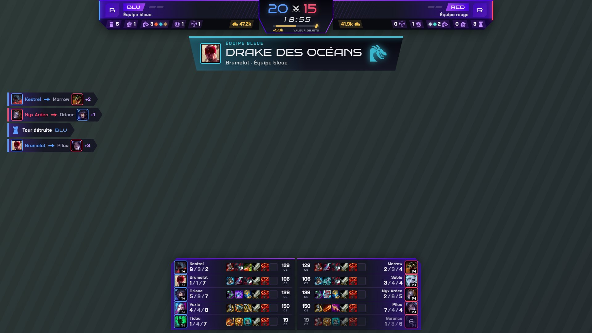
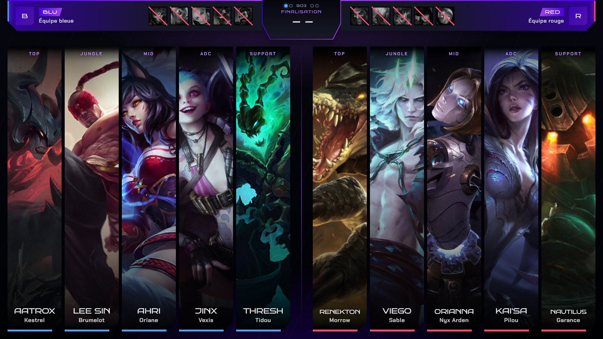
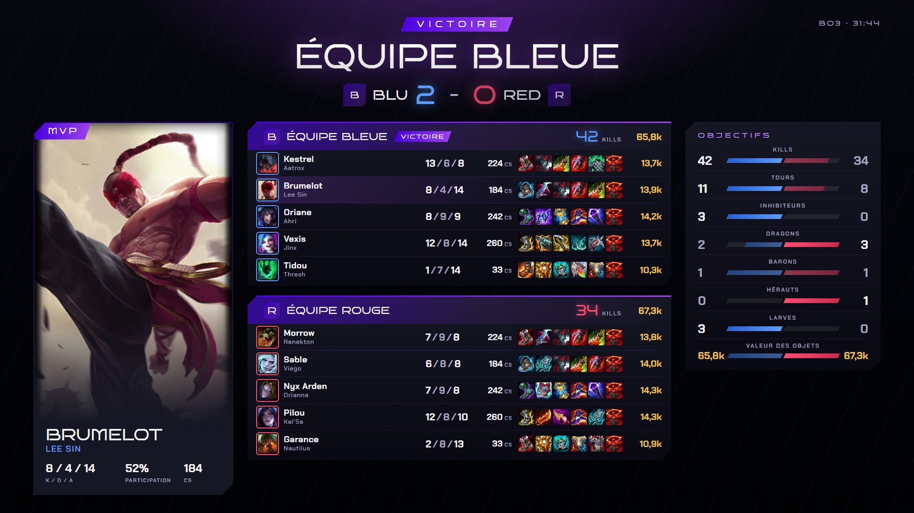
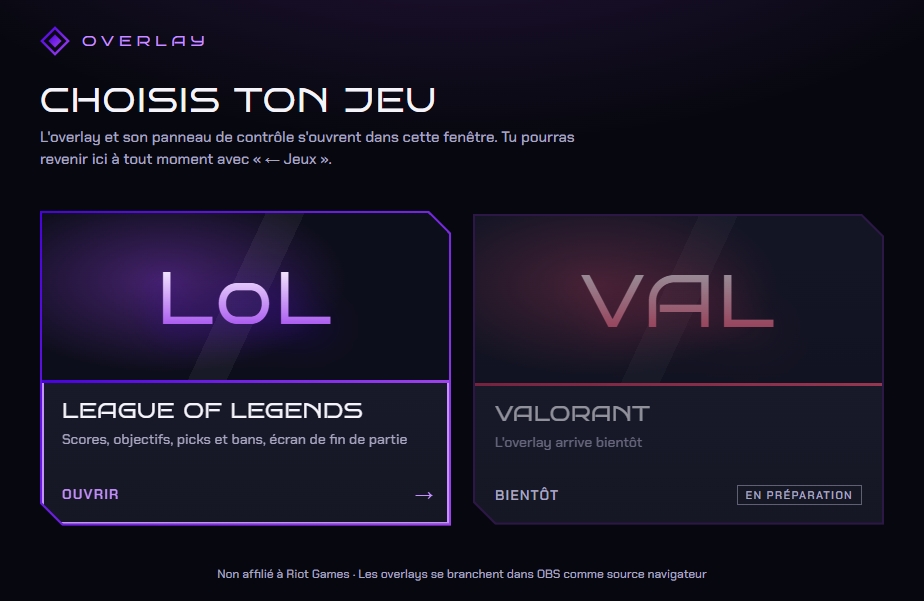
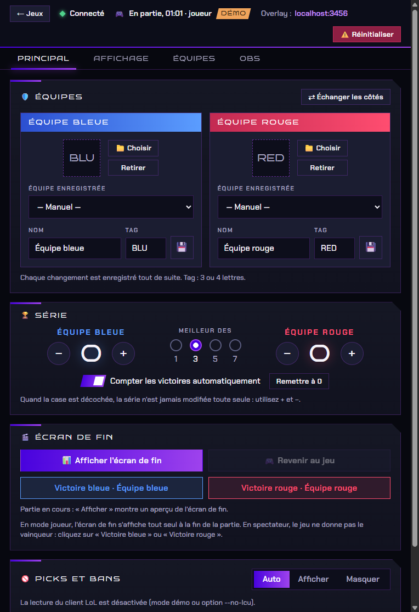

# Overlay Twitch pour League of Legends

Un overlay de diffusion pour OBS, sur le même principe que JotaOverlay pour Rocket League : un petit programme local lit les données de la partie en cours, un serveur les redistribue, une page « overlay » s'ajoute dans OBS comme **source navigateur**, et un **panneau de contrôle** règle les noms d'équipes, les logos, le score de la série et ce qui s'affiche. Le design suit la charte graphique Genesis.

La source de données est l'API officielle et locale du jeu, la *Live Client Data API*. Il n'y a **aucune lecture de la mémoire du jeu** (donc aucun souci avec Vanguard) et **aucune clé API Riot** à demander.

**Pas encore de version à télécharger** : l'application se fabrique en trois commandes, voir « Fabriquer l'application » plus bas. Pour essayer tout de suite, installez [Node.js](https://nodejs.org) et double-cliquez sur `start-demo.bat`.

> Ce projet n'est ni approuvé ni affilié à Riot Games. League of Legends est une marque de Riot Games, Inc. Les icônes de champions et d'objets viennent de Data Dragon, le service public de Riot pour les développeurs.

## Captures d'écran





<p align="center">
  
  
</p>

*Les captures viennent du mode démo, avec les équipes par défaut : aucun vrai joueur, aucun logo.*

## Mise en place pour le stream

1. **Lancer l'application**
   - [ ] Ouvrez `Overlay-LoL.exe` (ou double-cliquez sur `start.bat` si vous utilisez Node.js).
   - [ ] Dans l'écran de choix, cliquez sur **League of Legends**. Le panneau de contrôle s'affiche dans la même fenêtre.
   - [ ] Gardez cette fenêtre ouverte pendant le stream : **la fermer arrête l'overlay dans OBS** (le programme demande confirmation).
2. **Ajouter l'overlay dans OBS**
   - [ ] Dans la scène de jeu : **Sources → + → Navigateur**.
   - [ ] Collez l'adresse (le panneau, onglet **OBS**, la donne avec un bouton « Copier ») :
     ```
     http://localhost:3000/overlay
     ```
   - [ ] **Largeur** `1920`, **Hauteur** `1080`. Le fond est transparent : l'overlay se superpose à la capture du jeu.
   - [ ] Placez la source **au-dessus** de la capture de League of Legends.
   - *Si vous diffusez en 1280×720, laissez quand même la source en 1920×1080 : OBS la réduit avec le reste de la scène.*
3. **Régler le panneau de contrôle**
   - [ ] Onglet **Principal** : noms, tags et logos des équipes, format de la série (BO1, BO3, BO5 ou BO7).
   - [ ] Onglet **Affichage** : mode **Joueur** (le bas de l'écran reste libre pour la barre des sorts) ou **Spectateur** (tableau des joueurs en bas).
   - [ ] Chaque changement est enregistré tout de suite, il n'y a pas de bouton « Enregistrer ».
4. **Picks et bans** *(facultatif, scène dédiée)*
   - [ ] La source `/overlay` les affiche déjà toute seule pendant la sélection des champions.
   - [ ] Pour une scène OBS réservée à la sélection, ajoutez une seconde source navigateur 1920×1080 sur `http://localhost:3000/overlay?view=draft` : elle n'affiche que les picks et bans.
5. **Lancer la partie**
   - [ ] Dès que la partie est chargée, le statut du panneau passe à « En partie » et l'overlay apparaît.
   - [ ] À la fin, l'écran de fin s'affiche tout seul (en spectateur : cliquez sur « Victoire bleue » ou « Victoire rouge »).

Pas de jeu sous la main ? Double-cliquez sur `start-demo.bat` : la démo complète enchaîne sélection des champions, partie et écran de fin.

## Fonctionnalités

- **Barre de score** en haut au centre
  - Plaque centrale : kills de chaque équipe, chrono et jauge de valeur des objets.
  - De chaque côté : logo, tag, nom et pastilles de série, puis un bandeau avec les tours, inhibiteurs, dragons (losanges colorés selon l'élément, mention « Âme » à 4), hérauts, barons et valeur des objets.
- **Fil d'actions** à gauche : kills (tueur → victime, assistances) et tours détruites.
- **Bandeaux d'objectifs** sous la barre : dragons (volés ou non), Nashor, Héraut, Atakhan, inhibiteurs, premier sang, triple, quadra et pentakill, ace.
- **Tableau des joueurs** en bas au centre : deux colonnes de 5 lignes alignées par poste, avec champion, niveau, nom, K/D/A, objets et CS, et le temps de réapparition des joueurs morts. Affiché par défaut en mode spectateur.
- **Picks et bans** plein écran pendant la sélection des champions : bans barrés, cinq grandes colonnes par équipe avec l'illustration du champion et le nom du joueur, chrono, étape en cours, équipe qui joue et score de la série.
- **Écran de fin** plein écran : équipe gagnante, score de la série, MVP, tableau des 10 joueurs et comparatif des objectifs.
- **Sponsors** en rotation en haut à gauche.
- **Choix du jeu** au lancement de l'application : League of Legends est prêt, VALORANT est annoncé « Bientôt ».

### Typographie

Les polices de la charte, **Bruno Ace SC** (titres, chiffres) et **Chakra Petch** (textes), sont livrées avec le programme : il n'y a rien à installer. Les couleurs de la charte sont `#D9D9D9`, `#000103`, `#151724`, `#9E42ED` et `#4802DE` ; seuls le bleu et le rouge des deux côtés de la partie, l'or et les couleurs des dragons s'y ajoutent, parce que le spectateur en a besoin pour lire la partie.

## Fonctions avancées

### Presets d'équipes

Le bouton 💾 de chaque carte d'équipe enregistre un nom, un tag et un logo. Rechargez-les en un clic avec la liste « Équipe enregistrée », côté bleu ou rouge. Entre deux games, **« Échanger les côtés »** échange les équipes bleue et rouge avec leurs scores ; **+**, **−** et **« Remettre à 0 »** corrigent la série à la main.

### Logos personnalisés

Envoyez un logo depuis le panneau (png, jpg, webp ou gif, 5 Mo maximum) : il apparaît partout, dans la barre, les picks et bans et l'écran de fin. Si l'image ne charge pas, l'overlay affiche le tag de l'équipe à la place. Pour le logo Genesis, envoyez simplement son fichier comme logo d'équipe.

### Détection du vainqueur

- **En joueur**, le vainqueur est connu à la fin de la partie : l'écran de fin s'affiche tout seul et la victoire s'ajoute à la série (si « Compter les victoires automatiquement » est coché).
- **En spectateur**, l'API ne donne **pas** le vainqueur : cliquez sur **« Victoire bleue »** ou **« Victoire rouge »**. Cela fixe le vainqueur, met la série à jour et affiche l'écran de fin.

### Picks et bans

Pendant la sélection des champions, le client League of Legends ouvre une petite API locale. Le programme la lit toutes les secondes, comme Porofessor ou Blitz : il retrouve le port et le mot de passe dans le fichier `lockfile` du client (ou dans son processus, si LoL n'est pas installé dans `C:\Riot Games\League of Legends`). Il ne lit pas la mémoire du jeu et n'envoie rien hors de votre PC.

- **Auto** : affichés pendant la sélection, effacés ensuite. **Afficher** : affichage forcé, avec la dernière sélection vue (pratique pendant le chargement de la partie). **Masquer** : jamais affichés. Le réglage est dans la carte « Picks et bans » de l'onglet Principal.
- L'overlay montre ce que *votre* client montre, pas plus : il faut être en sélection des champions (classée, normale ou personnalisée). Les pseudos masqués par le client restent masqués.
- Cette API du client n'est **pas documentée officiellement** par Riot : une mise à jour du jeu peut la changer, et la lecture n'a pas encore été vérifiée avec un vrai client (voir « Dépannage »).
- Option `--no-lcu` (ou variable `NO_LCU=1`) pour désactiver complètement cette lecture. [drafter.lol](https://drafter.lol/) reste utilisable à côté pour un draft de tournoi arbitré à part.

### Spectateur sur un autre PC

Lancez le serveur sur le PC spectateur en l'ouvrant au réseau local :

```bat
set HOST=0.0.0.0
Overlay-LoL.exe
```

Dans OBS, utilisez ensuite l'adresse de ce PC : `http://ADRESSE-IP-DU-PC-SPECTATEUR:3000/overlay`. Windows peut demander d'autoriser le programme dans le pare-feu : acceptez pour les réseaux privés. Avec `HOST=0.0.0.0`, le panneau de contrôle est accessible à tout le réseau local, sans mot de passe ; par défaut, le serveur n'écoute que sur `127.0.0.1`.

### Mode démo

```bat
node server.js --demo --full
node server.js --demo --speed=12 --start=900 --spectator
```

- `--full` : **démo complète**. Sélection des champions (bans, picks, finalisation), partie avec les champions choisis, écran de fin, puis une nouvelle sélection. À vitesse ×12, un tour dure environ quatre minutes ; `--speed=60` le ramène à une minute et demie.
- `--draft` : uniquement la sélection des champions, en boucle (`node server.js --demo --draft --speed=4`).
- `--speed=12` : vitesse de la partie simulée. `--start=900` : départ à 15:00. `--spectator` : partie vue en spectateur.

Avec l'application : `Overlay-LoL.exe --demo --full`.

### Ajouter un jeu (par exemple VALORANT)

Dans `app/games.js`, l'entrée du jeu passe de `status: 'soon'` à `status: 'ready'` et reçoit une fonction `start()` qui démarre son serveur et renvoie l'adresse de son panneau de contrôle (`{ url }`), comme celle de LoL. L'écran de choix, le bouton « ← Jeux », la mémoire du dernier jeu utilisé et la confirmation à la fermeture s'adaptent tout seuls, et `npm test` vérifie que la liste reste cohérente.

---

## 🏗️ Architecture du système

1. **Données de jeu** : la *Live Client Data API* du jeu (`https://127.0.0.1:2999`) répond dès qu'une partie est chargée, en joueur comme en spectateur. Pendant la sélection des champions, le client LoL fournit les picks et bans par sa propre API locale.
2. **Serveur Node.js** (`server.js`, sans aucune dépendance) : il interroge ces deux sources, fusionne l'état avec les réglages du panneau, et le diffuse par *Server-Sent Events* sur `/events`.
3. **Interfaces** : la page `/overlay` (source navigateur d'OBS) et la page `/control` (panneau) se mettent à jour en direct.
4. **Application de bureau** (Electron) : un écran de choix du jeu, puis le serveur du jeu choisi et son panneau dans la même fenêtre.

---

## 📁 Guide des fichiers

### Noyau du système
- `server.js` : serveur HTTP, Server-Sent Events, API du panneau.
- `lib/game.js` : transforme la réponse de l'API en état d'overlay (événements, équipes, objectifs).
- `lib/draft.js` : met en forme la sélection des champions (picks et bans).
- `lib/lcu.js` : lecture du client LoL (port et mot de passe locaux).
- `lib/demo.js` et `lib/demo-draft.js` : simulateurs de partie et de sélection pour le mode démo.

### Interfaces
- `public/overlay/` : l'overlay pour OBS.
- `public/control/` : le panneau de contrôle.
- `public/shared/` : polices de la charte (licence OFL).

### Application de bureau
- `app/main.js` : fenêtre Electron, choix du jeu, puis serveur et panneau du jeu choisi.
- `app/games.js` : la liste des jeux (LoL prêt, VALORANT à venir).
- `app/launcher/` : l'écran de choix du jeu.
- `app/preload.js` : le petit pont entre les pages et l'application (choisir un jeu, revenir).

### Ressources et persistance
- `data/` : configuration, logos et journal (créé au premier lancement, à côté du `.exe` pour les versions fabriquées). Il n'est jamais envoyé sur GitHub.
- `screenshots/` : les captures de ce README.
- `dist/` : les programmes fabriqués (non versionné).

### Fabrication et tests
- `build/build-app.js` : fabrique l'application (`npm run build:app`).
- `build/build-exe.js` : fabrique le serveur seul en `.exe` (`npm run build:exe`).
- `build/icon.js` : l'icône de l'application, dessinée en code.
- `test/` : tests automatiques (`npm test`, aucune dépendance).

---

## 🔌 Intégration avec les API du jeu

### 1. Connexion technique

Pendant une partie, le serveur interroge toutes les secondes :

```
https://127.0.0.1:2999/liveclientdata/allgamedata
```

Le certificat du jeu est auto-signé : il n'est ignoré que pour cette adresse locale. Pendant la sélection des champions, il lit le client LoL sur `/lol-champ-select/v1/session`, avec le port et le mot de passe du fichier `lockfile`. Pour développeurs : `GET /api/state` renvoie l'état complet, `GET /events` le diffuse en Server-Sent Events, et `GET /api/draft/raw` montre la réponse brute du client pendant une sélection.

### 2. Événements traités

- `ChampionKill`, `FirstBlood`, `Multikill`, `Ace`
- `DragonKill`, `BaronKill`, `HeraldKill`, `HordeKill` (larves), `AtakhanKill`
- `TurretKilled`, `InhibKilled`
- `GameEnd` (vainqueur en mode joueur)

Si vous lancez le serveur en cours de partie, l'historique n'est pas rejoué à l'écran : seuls les nouveaux événements s'affichent.

### 3. 🩺 Dépannage

- **Le panneau reste sur « En attente d'une partie »** : l'API du jeu ne répond qu'une fois la partie chargée (pas dans le client, ni pendant la sélection des champions). Pour vérifier, ouvrez `https://127.0.0.1:2999/liveclientdata/allgamedata` dans un navigateur pendant une partie : acceptez l'avertissement de certificat et vous devez voir du JSON. Si rien ne répond, vérifiez le pare-feu et les logiciels de sécurité. Si le jeu tourne sur un autre PC, lancez le serveur sur ce PC.
- **Le statut reste sur « Chargement »** : l'API répond mais la partie n'a pas encore de joueurs, cela passe tout seul au début de la partie.
- **Les picks et bans n'apparaissent pas** alors que le panneau indique « Client LoL détecté » : ouvrez `http://localhost:3000/api/draft/raw` pendant une sélection et gardez la réponse, c'est ce qui permet de comprendre ce qui a changé.
- **« Le port 3000 est déjà utilisé »** : une autre copie du programme tourne déjà. Fermez-la, ou changez de port : `set PORT=3001` puis relancez (pensez à changer l'adresse dans OBS).
- **L'overlay est vide dans OBS** : vérifiez l'adresse (`/overlay`, sans `?preview=1`), la taille 1920×1080 et que le serveur tourne. L'overlay n'affiche rien tant qu'aucune partie n'est en cours : testez avec `start-demo.bat`. Le bouton d'actualisation du cache dans les propriétés de la source recharge la page.
- **L'application ne démarre pas ou se ferme tout de suite** : regardez `data/overlay.log` (à côté de `Overlay-LoL.exe`).
- **Remettre les réglages à zéro** : bouton « Tout réinitialiser » du panneau. Pour tout effacer, y compris presets et logos, arrêtez le programme et supprimez le dossier `data/`.
- **Windows affiche « Windows a protégé votre ordinateur »** : le programme n'est pas signé numériquement. Cliquez sur **Informations complémentaires**, puis **Exécuter quand même**.

### Limites

- **L'or affiché est la valeur des objets**, pas l'or réel : l'API ne donne pas l'or des adversaires.
- Pas de points de vie, pas de positions, pas de données de la carte : l'API locale ne les fournit pas.
- Sans connexion Internet, les icônes de Data Dragon sont remplacées par des pastilles avec les initiales.

---

## 🛠️ Fabriquer l'application

À faire sous Windows, avec Node.js 20 ou plus récent (testé avec Node.js 24), depuis le dossier du projet :

1. Installez les outils de fabrication : `npm install`.
2. Fabriquez l'application : `npm run build:app`. Le premier lancement télécharge Electron (environ 120 Mo).
3. Récupérez **`dist/Overlay-LoL/Overlay-LoL.exe`** : le dossier est autonome (environ 300 Mo), copiez-le où vous voulez.

Et aussi :

- `npm run build:exe` fabrique `dist/Overlay-LoL-serveur.exe` (environ 88 Mo), le serveur seul : une console s'ouvre et le panneau s'ouvre dans le navigateur.
- `npm run app` lance l'application directement depuis les sources.
- `npm test` lance les tests.
- Les réglages d'un dossier `data/` déjà présent dans `dist/Overlay-LoL/` sont conservés à chaque fabrication.

Les outils de fabrication (`electron`, `@electron/packager`, `esbuild`, `postject`, `rcedit`) ne servent qu'à cette étape, jamais au fonctionnement du serveur. Sans eux : `node server.js` (ou `start.bat`) suffit, le panneau s'ouvre alors dans le navigateur, directement sur League of Legends.

## Crédits

- **Icônes des objectifs** (tour, inhibiteur, dragon, héraut, Nashor, or, épées croisées) : [game-icons.net](https://game-icons.net), licence [CC BY 3.0](https://creativecommons.org/licenses/by/3.0/). Icons made by **Lorc** (`white-tower`, `crystal-growth`, `dragon-head`, `beast-eye`, `horned-skull`, `crossed-swords`) and **Delapouite** (`two-coins`). Les tracés sont repris tels quels et seulement recolorés par la feuille de style.
- **Polices** : Bruno Ace SC et Chakra Petch (SIL Open Font License 1.1).
- **Icônes de champions et d'objets**, et illustrations des champions : Data Dragon, le service public de Riot Games pour les développeurs.

## Licence

Le code est publié sous licence [MIT](LICENSE). Les polices Bruno Ace SC et Chakra Petch sont sous licence SIL Open Font License 1.1 (voir `public/shared/fonts/LICENSE-*.txt`), et les icônes de game-icons.net sous licence CC BY 3.0 (voir « Crédits »). Les noms, logos et marques cités (League of Legends, Riot Games, Genesis, OBS…) appartiennent à leurs propriétaires respectifs.
